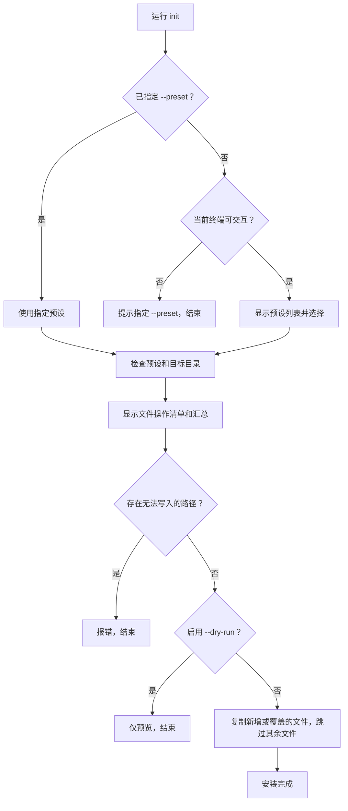

# agent-docs-cli

在已有项目中安装 `AGENTS.md` 和 `docs/` 开发规范。运行命令后选择一套预设，CLI 将该预设的文件复制到当前项目。当前内置 `default`。

## 使用方式

需要 Node.js 20 或更高版本。进入已有项目后执行：

```powershell
cd ./my-project
npx agent-docs-cli@latest init
```

CLI 会列出可用预设，可输入编号或名称；直接回车选择第一项。选定后会显示每个文件的处理方式，并立即执行安装。非交互环境须使用 `--preset`。若希望固定模板版本，把 `@latest` 换成具体版本号

### `init` 执行流程



## 命令与参数

| 命令                                    | 功能                                                      |
| --------------------------------------- | --------------------------------------------------------- |
| `npx agent-docs-cli@latest init`      | 选择预设并安装到当前目录；省略子命令时也会执行 `init`。 |
| `npx agent-docs-cli@latest list`      | 列出可用预设；目前只有 `default`。                      |
| `npx agent-docs-cli@latest --help`    | 显示命令帮助。                                            |
| `npx agent-docs-cli@latest --version` | 显示 CLI 版本。                                           |

`init` 可使用以下参数：

| 参数                | 功能                                               |
| ------------------- | -------------------------------------------------- |
| `--preset <名称>` | 直接指定预设，跳过交互选择；非交互环境必填。       |
| `--target <目录>` | 指定已存在的目标目录；默认是执行命令时的当前目录。 |
| `--dry-run`       | 只预览文件处理清单，不写入文件。                   |
| `--force`         | 覆盖目标项目中与预设同名的普通文件。               |

例如，先预览覆盖范围，再执行安装：

```powershell
npx agent-docs-cli@latest init --preset default --dry-run --force
npx agent-docs-cli@latest init --preset default --force
```

CLI 会逐个标明新增、跳过或覆盖的文件。已有文件默认跳过；目标路径是目录、符号链接或上级路径无法写入时，安装会中止。

更新模板后，在本仓库发布新 npm 版本，目标项目再运行 `npx agent-docs-cli@latest init --preset default --force` 即可覆盖对应文件。**覆盖会丢弃这些文件的本地修改**；可先用 `--dry-run` 查看清单。CLI 不删除旧版预设中有、但新版已移除的文件。需要完整替换时，可自行删除目标项目中对应的 `AGENTS.md` 和模板文档后重新运行 `init`。如果目标项目的 `docs/` 中还有自己的内容，只删除确认属于模板的文件。

不建议把整个 `docs/` 目录作为 CLI 的自动清理范围：其中可能已有项目自己的文档。由于没有状态文件，CLI 也无法可靠判断一个现有文件是否被用户改过。

## 许可证

本项目的代码和预设模板均采用 [MIT License](LICENSE)。将模板复制到其他项目并再次分发时，请保留相应的版权和许可声明。

## 维护与发布

本仓库使用 GitHub Actions 在推送 `v*` 标签后发布到 npm。日常修改完成后，在本地 `main` 运行交互式发版命令；不需要在本地执行 `npm publish`。

```powershell
npm run release
```

`npm run release` 依次执行：

1. 选择 `patch`、`minor` 或 `major`。例如从 `0.2.1` 选择 `patch` 会得到 `0.2.2`。
2. 检查当前分支是 `main`、远端 `main` 没有本地缺少的提交。若工作区有未提交的改动，列出文件并询问是否将这些改动全部提交；可以自行输入提交说明。
3. 检查目标版本尚未发布，运行测试，并检查 npm 包包含 `LICENSE`。
4. 显示将创建的版本和标签。只有输入完整版本标签（如 `v0.2.2`）确认后，才会用 `npm version` 创建版本提交和 Git 标签，依次推送 `main` 与该标签。已提交但尚未推送的本地改动也会随 `main` 一起推送。
5. 标签推送触发 [Publish to npm](.github/workflows/publish.yml)。在仓库的 **Actions** 页面查看日志；成功后可用 `npm view agent-docs-cli dist-tags --registry=https://registry.npmjs.org/` 核对 `latest`。

发版命令需要本地交互式终端、Git 推送权限，以及已在 npm 上配置与本仓库匹配的 Trusted Publisher。确认自动提交前，请核对脚本列出的文件。若版本提交和标签已经在本地创建、但推送因网络问题失败，先检查 `git status` 和 `git tag`，再重试 `git push origin main` 与 `git push origin v<版本号>`；不要再次运行发版命令来重试同一版本。npm 中已经发布的版本不能用相同版本号重新上传。

## 目录结构与新增预设

```text
agent-docs-cli/
├─ bin/
│  └─ agent-docs.mjs         # 命令入口与交互选择
├─ src/
│  ├─ install.mjs            # 预览、冲突检查与复制
│  └─ presets.mjs            # 自动发现预设、收集模板文件
├─ templates/
│  └─ default/
│     ├─ AGENTS.md           # 安装到目标项目根目录
│     └─ docs/
│        └─ standards/
│           └─ *.md          # 安装到目标项目的 docs/standards/
├─ test/
│  └─ install.test.mjs       # 行为测试
├─ scripts/
│  └─ release.mjs            # 交互式版本更新与发布
├─ .github/workflows/
│  ├─ ci.yml                 # main 与 PR 的检查
│  └─ publish.yml            # 标签触发 npm 发布
├─ .gitignore
├─ LICENSE                   # MIT License
├─ package.json              # 包信息与命令入口
├─ pnpm-lock.yaml
└─ README.md
```

新增预设只需在 `templates/` 下新建目录，例如 `templates/xxx-project/`，并放入该预设自己的 `AGENTS.md` 和所需文档。预设目录名使用小写字母、数字和连字符。CLI 会自动发现目录。每套预设的 `AGENTS.md` 链接应指向该预设实际包含的文件。目录内所有普通文件都会复制到目标项目。
